# Detecting AI-Generated Images via Self-Supervised Representations and Transfer Learning

## 1. Introduction / Background

Increasingly photorealistic deepfakes threaten brand safety and user trust. We developed authentication models that identify AI-generated content by optimizing for AUC-ROC across multiple architectures. This provides platforms with a reliable filter to mitigate misinformation and restore user confidence.

Advancements in Denoising Diffusion Probabilistic Models (DDPMs) have closed the gap between synthetic and natural image distributions [1]. However, research indicates these models often struggle with "spectral gaps", specific frequency signatures left by the upsampling and refinement processes [2]. Some research indicates using Steganalysis, treating generative artifacts as a form of hidden signal within the pixel noise, may be a worthwhile consideration [3]. To measure the information-theoretic difference between real and synthetic distributions, literature discusses the usage of Kullback–Leibler divergence and Frechet Inception Distance (FID) as comparative metrics for data manifold overlap [4].

Dataset: The ai-generated-images-vs-real-images dataset contains two classes (real and AI-generated) with 100,000 training images and 20,000 test images. AI images were generated using Stable Diffusion, MidJourney, and DALL-E.
- Source: [ai-generated-images-vs-real-images](https://www.kaggle.com/datasets/tristanzhang32/ai-generated-images-vs-real-images)

## 2. Problem Definition

Recent advances in generative models make manual detection of AI images increasingly difficult. While supervised models achieve high benchmark accuracy, they often operate as "black boxes" [5]. This lack of interpretability makes it unclear whether these models rely on meaningful semantic cues or non-generalizable dataset artifacts.

Motivation:
Detectors often overfit to generator-specific frequency artifacts [6], necessitating approaches that pair predictive performance with representation-level analysis. Self-supervised models like DINO learn semantic features without labels [7]. This project leverages these representations for both unsupervised analysis and supervised classification to determine if models can learn interpretable distinctions between real and AI-generated images.

Key Question: Can self-supervised representations (DINO) provide both interpretable and robust AI-image detection?

## 3. Methods

### 3.1 Data Preprocessing

We implemented three forms of data preprocessing to improve the robustness of our models:

- JPEG Compression (quality = 75–85) [8]: AI-generated images online may have gone through compression when being uploaded or downloaded, masking noise signatures. Pre-compressing training images made our model more robust against compressed AI-generated images.

- Gaussian Blur (radius = 0.5–2.0) [9]: We applied Gaussian blur to force the model to prioritize intrinsic semantic features over high-frequency artifacts. Since deepfakes often use blurring to mask blending seams, including blurred samples enhances robustness in detecting partially AI-generated content.

- Gaussian Noise (sigma = 2–10) [10]: We added Gaussian noise to prevent models from overfitting to AI-specific artifacts or hardware-specific signatures (e.g., camera settings). This augmentation ensures the classifier relies on robust features rather than non-generalizable noise patterns.

### 3.2 Feature Extraction — DINO Vision Transformer

We computed feature embeddings for each image using a pretrained self-supervised Vision Transformer (DINO ViT-S/16) [11]. This converts raw image data into 384-dimensional semantic representations suitable for both unsupervised analysis and supervised learning. DINO is trained without labels, so the resulting representations are not biased toward any particular classification task.

### 3.3 Unsupervised Analysis (Pipeline A — DINO Embeddings)

To understand the structure of the embedding space before applying supervised methods, we performed several unsupervised analyses:

- PCA (Principal Component Analysis): Applied to 384-d DINO embeddings to identify directions of maximum variance and assess whether the real/fake distinction aligns with dominant components. We computed up to 50 principal components and analyzed the explained variance.

- t-SNE: 2D visualization with perplexity=30 and 1,000 iterations to reveal non-linear cluster structure in embedding space.

- UMAP: 2D projection for non-linear dimensionality reduction, providing an alternative view of class separability.

- k-Means Clustering (k=2): Applied directly on DINO embeddings to evaluate whether unsupervised grouping recovers the real/fake labels, measured via silhouette score and cluster purity.

### 3.4 Supervised Classifiers (Pipeline A — DINO Embeddings)

We trained three supervised classifiers on the DINO embeddings:

- Logistic Regression (max_iter=2000): Linear baseline to test whether a simple decision boundary suffices.

- Support Vector Machine (SVM) (probability=True): Margin-maximizing linear separator that exploits the geometric structure of the embedding space.

- Random Forest (n_estimators=200): Non-linear ensemble using axis-aligned decision splits, providing contrast against linear methods.

These varied classifiers capture different levels of flexibility, allowing us to determine whether the real/fake boundary is linear or requires non-linear modeling.

### 3.5 CNN Transfer Learning (Pipeline B — ResNet-18)

To push accuracy beyond the frozen-feature ceiling, we fine-tuned an ImageNet-pretrained ResNet-18 end-to-end:

- Replaced the final fully connected layer with a 2-class output
- Optimizer: Adam (lr = 1×10⁻⁴)
- Loss: Cross-Entropy
- Epochs: 10, Batch size: 64
- Data augmentation: random crop, horizontal flip

### 3.6 Interpretability

- GradCAM [12]: Gradient-weighted Class Activation Mapping highlights which spatial regions most influence the CNN's decision, revealing whether the model focuses on meaningful features or artifacts.

- Input-Space Prototypes: We optimized input pixels via gradient ascent to maximize class probability, with L2 and Total Variation regularization, revealing what the CNN considers "most real" or "most fake."

## 4. Results and Discussion

### 4.1 Unsupervised Analysis

#### PCA Explained Variance

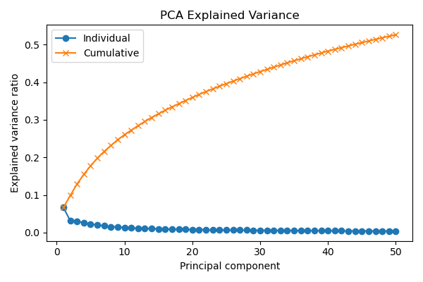

The first few principal components capture a moderate amount of variance, but the real/fake distinction does not align with the top components — suggesting the discriminative signal is distributed across many dimensions.

#### t-SNE and UMAP Visualizations

| t-SNE | UMAP |
|---|---|
| 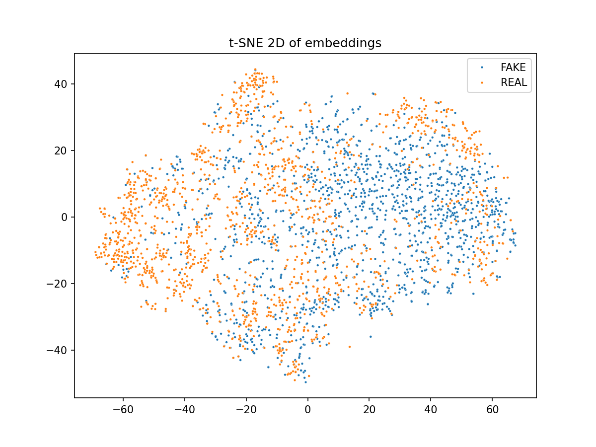 | 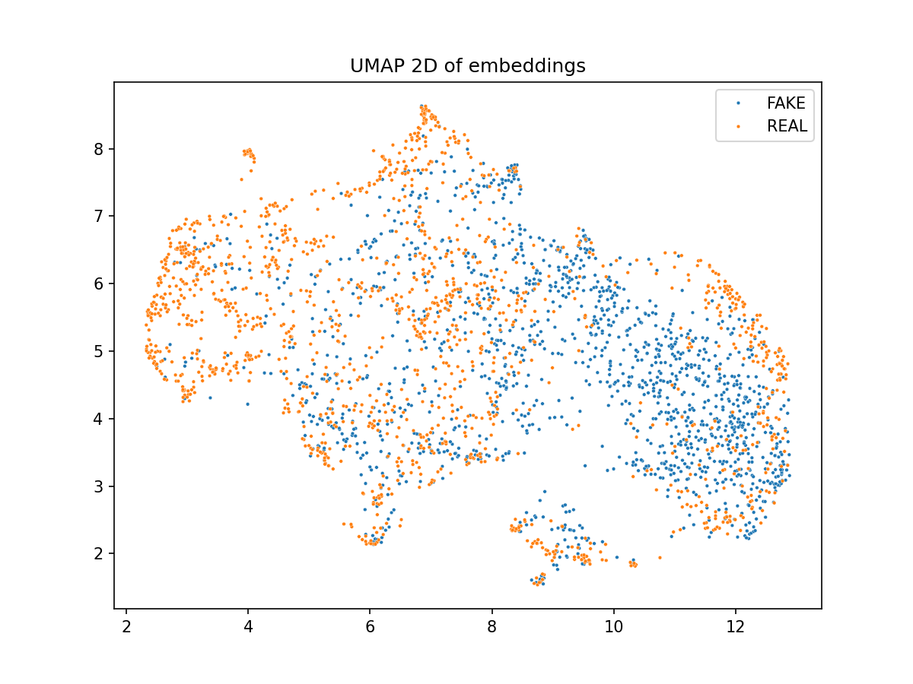 |

Both t-SNE and UMAP reveal partial but not clean separation between real (blue) and fake (red) images. The classes overlap considerably in the 2D projections, indicating that the DINO embedding space encodes the real/fake distinction as a secondary structure rather than a dominant visual cluster.

#### k-Means Clustering

k-Means clustering (k=2) on DINO embeddings yielded a silhouette score of 0.087, near zero, indicating that the clusters overlap heavily. This confirms that the real/fake boundary is not a simple geometric partition in embedding space. Despite this, supervised classifiers achieve AUC > 0.93 on the same embeddings, demonstrating that the signal exists as a learnable boundary that requires label supervision to exploit.

### 4.2 Supervised Classifiers on DINO Embeddings (Baseline)

| Model | ROC-AUC | Accuracy |
|---|---|---|
| SVM | 0.938 | 86.7% |
| Logistic Regression | 0.910 | 84.0% |
| Random Forest | 0.900 | 81.8% |

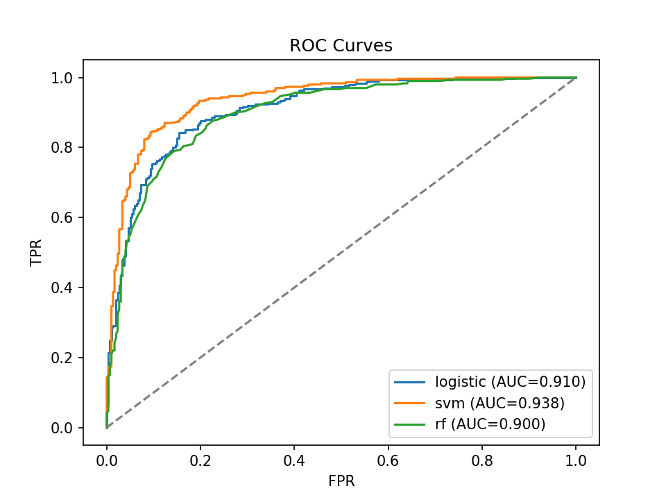

SVM achieves the best ROC-AUC of 0.938 and 86.7% accuracy. Its strong performance relative to Random Forest suggests the classes are largely linearly separable in embedding space. DINO, pre-trained on real imagery, encodes AI-generation artifacts into systematically different directions that a margin-maximizing hyperplane can cleanly exploit. Random Forest underperforms because axis-aligned splits are inefficient in dense, high-dimensional spaces. Even Logistic Regression achieves > 0.91 AUC, confirming near-linear separability.

### 4.3 Robustness of DINO-Based Classifiers

We evaluated all three classifiers under three augmentation conditions to test real-world robustness:

| Model | Condition | ROC-AUC | Accuracy |
|---|---|---|---|
| Logistic | Baseline | 0.910 | 84.0% |
| Logistic | Blur | 0.919 | 84.7% |
| Logistic | Compression | 0.914 | 82.6% |
| Logistic | Noise | 0.910 | 83.6% |
| SVM | Baseline | 0.938 | 86.7% |
| SVM | Blur | 0.944 | 87.1% |
| SVM | Compression | 0.938 | 85.9% |
| SVM | Noise | 0.933 | 85.9% |
| RF | Baseline | 0.900 | 81.8% |
| RF | Blur | 0.882 | 79.9% |
| RF | Compression | 0.877 | 79.6% |
| RF | Noise | 0.861 | 77.3% |

*Table 2: Classifier performance across augmentation conditions.*

| Baseline | Blur | Compression | Noise |
|---|---|---|---|
|  | 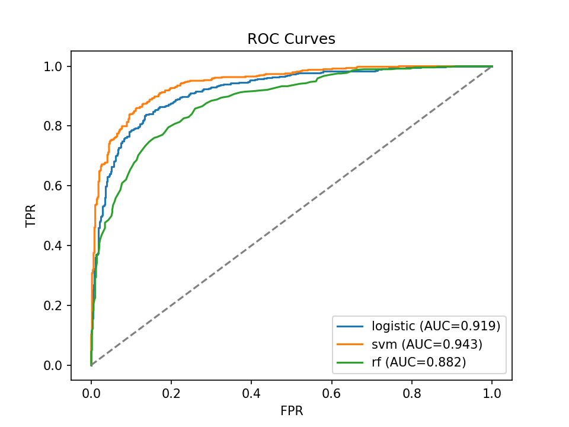 | 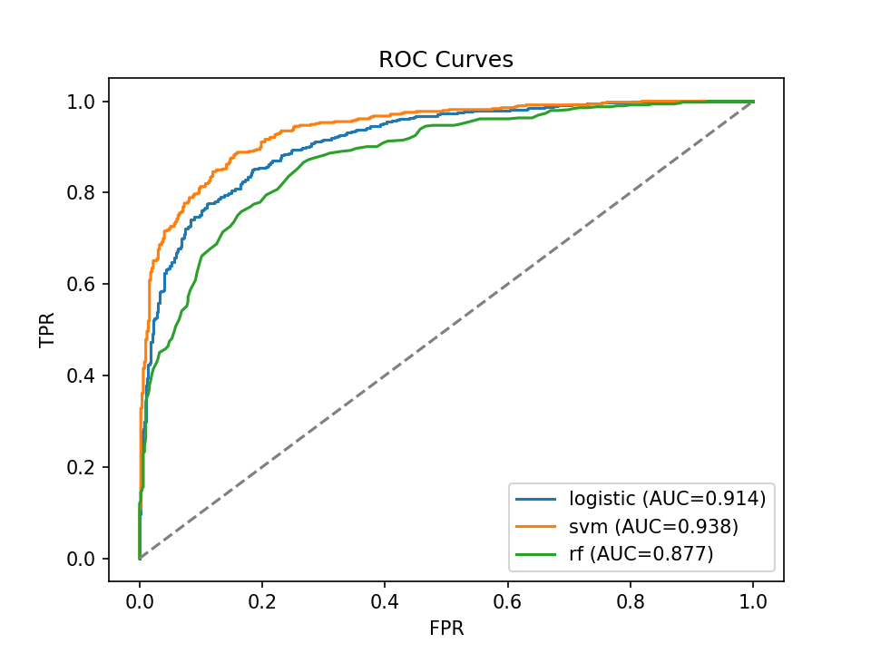 | 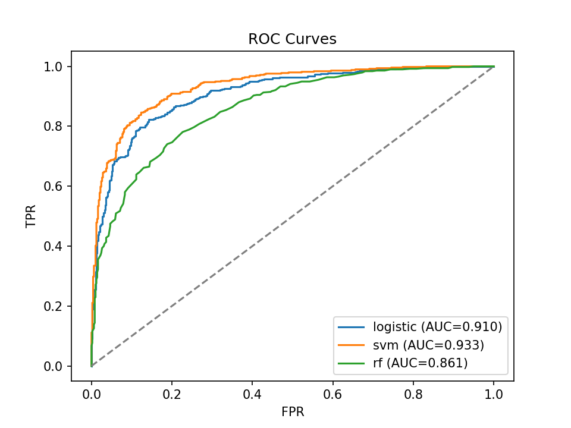 |

*Figure: ROC curves under each augmentation condition.*

Key findings:
- SVM is the most robust classifier, maintaining AUC between 0.933–0.944 across all conditions. Blur actually improves SVM performance slightly (0.944 vs. 0.938), likely because blurring removes high-frequency noise that occasionally confuses the decision boundary.
- Random Forest degrades the most under augmentation, dropping from 0.900 to 0.861 under noise, a 4.3% relative decrease. This confirms that axis-aligned splits in high-dimensional embedding space are fragile to perturbations.
- Logistic Regression is surprisingly stable, varying only ±0.009 in AUC across conditions.

### 4.4 CNN Transfer Learning — ResNet-18

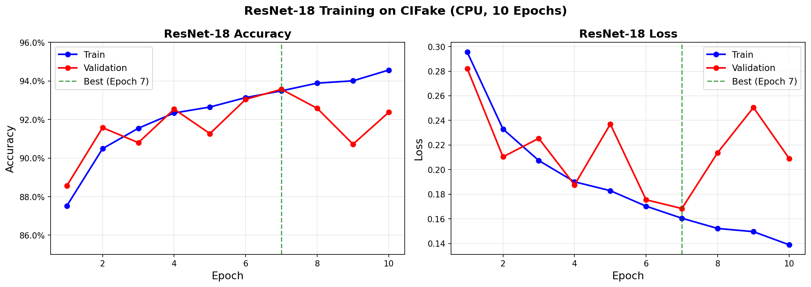

The fine-tuned ResNet-18 achieved 93.8% test accuracy and 0.983 ROC-AUC on clean data, a substantial improvement over the DINO embedding classifiers.

### 4.5 Interpretability

#### GradCAM

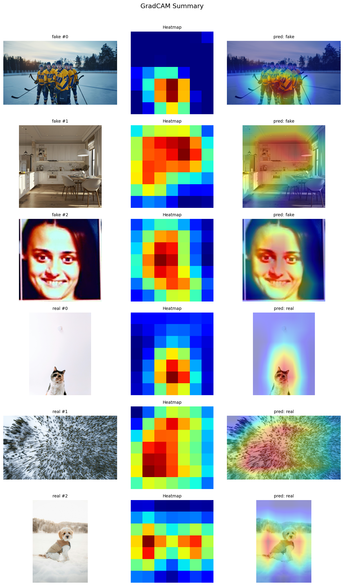

GradCAM visualizations reveal that:
- AI-generated images: The CNN focuses on texture irregularities and artifact-rich regions, areas where the diffusion model introduces subtle but detectable patterns.
- Real images: Attention is distributed across semantically meaningful objects, reflecting natural image statistics.

This confirms that the CNN learns meaningful discriminative features rather than memorizing dataset-specific shortcuts.

#### Input-Space Prototypes

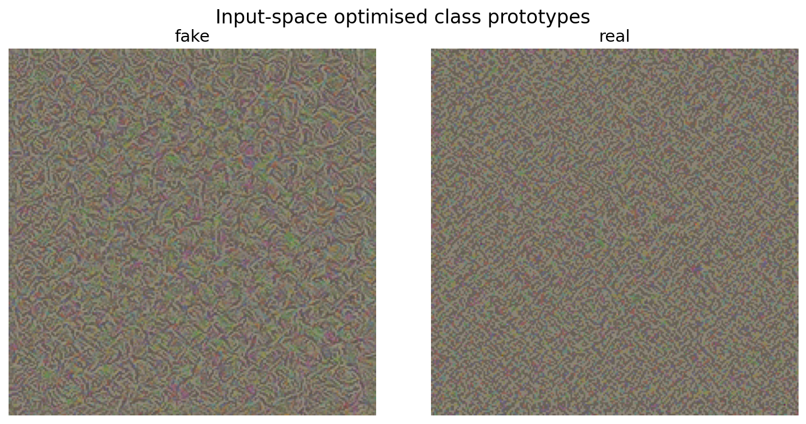

The optimized "most fake" prototype exhibits repetitive texture patterns characteristic of diffusion model outputs, while the "most real" prototype shows natural variation and organic edges. This provides visual confirmation that the model has learned to distinguish structural differences between real and AI-generated images.

### 4.6 Model Comparison

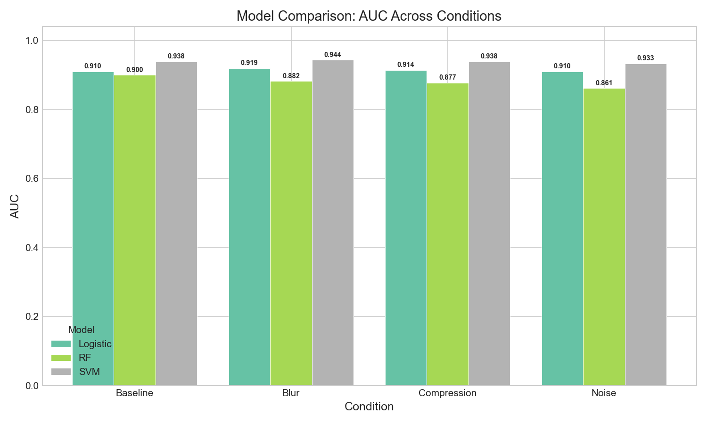

*Figure: AUC comparison across all models and conditions.*

| Approach | Best AUC | Accuracy | Strengths | Limitations |
|---|---|---|---|---|
| ResNet-18 (fine-tuned) | 0.983 | 93.8% | Highest accuracy; learns end-to-end | Black box without GradCAM; higher compute cost |
| SVM on DINO | 0.938 | 86.7% | Robust across conditions; fast inference | Frozen features limit ceiling |
| Logistic Regression on DINO | 0.910 | 84.0% | Most interpretable; stable under perturbation | Lowest accuracy |
| Random Forest on DINO | 0.900 | 81.8% | Non-linear; feature importance available | Degrades most under augmentation |

*Table 3: Summary comparison of all models.*

The CNN achieves the highest raw accuracy at 0.983 AUC, while the DINO-based classifiers offer greater interpretability and simplicity since they require no fine-tuning and run efficiently with standard ML classifiers. The strong performance of Logistic Regression (AUC > 0.91) confirms that DINO embeddings encode a real/fake signal that is largely linearly separable. Among the embedding-based classifiers, SVM consistently outperforms the others across all augmentation conditions, making it the best choice for the DINO pipeline.

Robustness varies by augmentation type. Noise is the most damaging corruption for all models, while blur and compression have minimal impact. The unsupervised analysis, with a silhouette score of just 0.087, reveals that the real/fake distinction is not a dominant cluster structure in DINO space. This insight motivates the need for supervised methods and explains why simple k-Means fails to recover class labels on its own.

### 4.7 Next Steps

To address a few shortcomings of our current approaches we believe the following next steps to be beneficial:

- Test on diverse generators (Stable Diffusion, DALL-E, Midjourney) to evaluate cross-generator generalization
- Ensemble DINO + CNN for improved robustness — combine the interpretability of DINO classifiers with the accuracy of ResNet
- Scale to larger DINO models (ViT-B, ViT-L) to determine if larger self-supervised models improve embedding quality
- Cross-dataset generalization study to move beyond the single-dataset (CIFake) limitation

## 5. References

[1] J. Ho, A. Jain, and P. Abbeel, "Denoising diffusion probabilistic models," in Advances in Neural Information Processing Systems (NeurIPS), 2020, vol. 33, pp. 6840–6851.

[2] T. Dzanic, K. Shah, and F. D. Witherden, "Fourier spectrum discrepancies in deep network generated images," in Advances in Neural Information Processing Systems (NeurIPS), 2020, vol. 33, pp. 3022–3032.

[3] F. Marra, D. Gragnaniello, L. Verdoliva, and G. Poggi, "Detection of GAN-generated fake images over social networks," in 2018 IEEE Conference on Multimedia Information Processing and Retrieval (MIPR), Miami, FL, USA, 2018, pp. 510–515.

[4] M. Heusel, H. Ramsauer, T. Unterthiner, B. Nessler, and S. Hochreiter, "GANs trained by a two time-scale update rule converge to a local Nash equilibrium," in Advances in Neural Information Processing Systems (NIPS), 2017, vol. 30, pp. 6626–6637.

[5] Z. Sun, N. Ruan, and J. Li, "DDL: Effective and Comprehensible Interpretation Framework for Diverse Deepfake Detectors," IEEE Transactions on Information Forensics and Security, vol. 20, pp. 3601–3615, 2025.

[6] Y. Jeong, D. Kim, Y. Ro, and J. Choi, "FrePGAN: Robust Deepfake Detection Using Frequency-level Perturbations," arXiv:2202.03347, 2022.

[7] M. Caron et al., "Emerging Properties in Self-Supervised Vision Transformers," arXiv:2104.14294, 2021.

[8] S.-Y. Wang, O. Wang, R. Zhang, A. Owens, and A. A. Efros, "CNN-generated images are surprisingly easy to spot... for now," in Proc. IEEE/CVF CVPR, 2020, pp. 8695–8704.

[9] B. Yousaf, M. Usama, W. Sultani, A. Mahmood, and J. Qadir, "Fake visual content detection using two-stream convolutional neural networks," arXiv:2101.00676, 2021.

[10] C.-T. Tsai, C.-Y. Ko, I-H. Chung, Y.-C. F. Wang, and P.-Y. Chen, "Understanding and improving training-free AI-generated image detections with vision foundation models," arXiv:2411.19117, 2024.

[11] J. Shen et al., "DINO-Detect: A simple yet effective framework for blur-robust AI-generated image detection," arXiv:2511.12511, 2025.

[12] R. R. Selvaraju, M. Cogswell, A. Das, R. Vedantam, D. Parikh, and D. Batra, "Grad-CAM: Visual Explanations from Deep Networks via Gradient-based Localization," in ICCV, 2017.

## 6. Gantt Chart

## 7. Contributions

| Name | Contributions |
|---|---|
| Alex | Unsupervised Analysis (PCA, t-SNE, UMAP), Gantt Chart Update |
| Raymond | Robustness Evaluation, Quantitative Metrics Compilation |
| Kevin | CNN Pipeline (ResNet-18 Training), Data Augmentation |
| Rohan | GradCAM & Interpretability, Results Discussion, Final Report Writing |
| Peter | Model Comparison, Presentation, Contribution Table |
